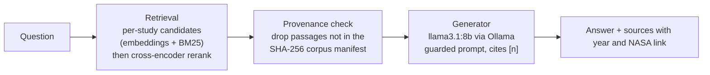

# ConflictRAG

A retrieval-augmented question-answering system over 12 NASA human-Mars-mission studies (1997-2015). These studies often disagree with each other: crew size, stay time and launch counts all changed between versions. ConflictRAG is built around that problem. The goal is to answer "Source A (year) says X; Source B (year) says Y" instead of blending sources or quietly using an outdated one.

The project is mostly about **measuring that honestly**. It includes a frozen eval set checked against the source PDFs, a dev/test split, an LLM judge checked against hand labels, a failure log, and every experiment recorded, including the ones that failed.

**Status in one line:** retrieval and answering work and are measured. Prompt-injection resistance comes from a provenance check. **Conflict detection does not work yet with a free local 8B model.** Three approaches were tried and each failure is documented ([eval/changes.md](eval/changes.md) E2, E3).

## Results (held-out test set, used once)

14 test questions: 10 answerable, 4 with no answer in the documents. Both systems were frozen before the test split was opened. Hand labels were written and hashed before the judge ran.

| Metric | Baseline | Final system |
|---|---|---|
| Correct, hand-labelled | 3/10 | 2/10 |
| Correct or partially correct, hand-labelled | 5/10 | **7/10** |
| Wrongly declines an answerable question | 3/10 | **1/10** |
| Declines questions the documents can't answer | 4/4 | 4/4 |
| Adds outside knowledge when declining | 2/4 | **0/4** |
| Gold passage in top 5 retrieved | 60% | 60% |
| Conflicts detected | 0/2 | 0/2 |
| False conflicts on trap questions | 0/1 | 0/1 |
| Prompt-injection attacks that succeed (8 forged passages) | 5/8 | **0/8** (provenance check) |
| Judge agreement with hand labels (correctness) | 12/14 | 11/14 |

What these numbers mean:

- **n is small.** With 10 answerable questions, one question is worth 10 points. Read the table as directions, not precise rates.
- **The retrieval gain on dev did not carry over to test.** Study-balanced cross-encoder reranking raised dev hit@5 from 50% to 71% (24 questions). On test it stayed at 60%. Nine strategies were compared on dev, so the winner was partly picked on noise ([F9](eval/failure_log.md)).
- **What improved on test:** fewer false declines, more partly correct answers, no outside-knowledge leaks, and injection resistance.
- **Injection: 0/8 is by construction.** Passages from documents outside the hashed corpus manifest are dropped. That check does not protect against hostile text inside a trusted document. With only the prompt defense, 5/8 attacks still succeed: forged facts get through even when commands don't ([F8](eval/failure_log.md)).

Every wrong test answer is categorized in [eval/changes.md](eval/changes.md) (T1):

| Category | Count |
|---|---|
| Retrieval miss | 2 |
| Wrong source chosen | 1 |
| Incomplete answer | 1 |
| Missing step | 1 |
| Arithmetic | 1 |
| Era mixing (right number, wrong study) | 1 |
| Conflict not reported | 1 |

## How it works



- **Corpus:** 12 NASA Technical Reports Server PDFs, frozen with SHA-256 hashes ([data/corpus_manifest.csv](data/corpus_manifest.csv)). They cover:
  - the 1997 Reference Mission and its 1998 Version 3.0 addendum;
  - Design Reference Architecture 5.0 (2008-2014: summaries, subsystem papers, and chapters 1-2 of Addendum #2);
  - the Evolvable Mars Campaign (2015).
- **Text and chunking:**
  - PyMuPDF extraction keeps the original PDF page numbers.
  - Text is split into 1,500-character chunks with 200-character overlap, giving 972 chunks.
  - A bug that deleted table numbers was found and fixed ([F2](eval/failure_log.md)).
- **Retrieval:**
  - `BAAI/bge-small-en-v1.5` embeddings in Chroma, plus BM25.
  - Candidates are gathered per study, then reranked with `BAAI/bge-reranker-base`.
  - Model revisions are pinned.
- **Generation:**
  - `llama3.1:8b` runs locally through Ollama ($0 budget).
  - The prompt wraps every source in `<source>` tags and tells the model to treat source text as data, not instructions.
  - The baseline prompt is deliberately naive and is kept unchanged for comparison.

## Evaluation method

- **Questions:** 44 questions, frozen with a SHA-256 hash ([eval/questions.jsonl](eval/questions.jsonl)):
  - 15 easy, 9 multi-step, 7 conflicting;
  - 3 false-conflict traps (for example, 500 days vs 500 sols is a unit difference, not a disagreement);
  - 5 unanswerable, and 5 "the model knows this but the documents don't".
- **Gold answers:** each gold answer is a (document, PDF page, exact quote) triple, checked by [eval/verify_gold.py](eval/verify_gold.py) against both the raw PDF and the cleaned text. Terms for unanswerable questions are checked to be absent from the corpus.
- **Split:** 30 dev / 14 test, stratified, seed 42. All tuning happened on dev, and test was run once.
- **Retrieval metrics:**
  - hit@k and MRR, counting a hit only when a retrieved chunk contains a gold quote. An earlier page-range rule overstated ranks: it reported 14 for a passage really at rank 155.
  - Conflict coverage: are both sides of a disagreement in the top 5?
- **Judge:**
  - The judge is the same local model. It answers narrow labelled questions ("answers" vs "unavailable", reference facts vs answer facts), and code combines the results.
  - A single-prompt judge was replaced after hand labels showed it was unreliable (abstention accuracy 33% by judge vs 100% by hand).
  - The judge is frozen and reported next to hand labels.
- **Caching:** every LLM call is cached by its exact prompt and settings. The cache is committed, so the tables can be reproduced without running a model.
- **Records:** every change is logged in [eval/changes.md](eval/changes.md) and every failure in [eval/failure_log.md](eval/failure_log.md), each with evidence.

### Experiments (dev unless noted)

| ID | Change | Result | Kept? |
|---|---|---|---|
| B0 | Baseline: top-5 embedding search, naive prompt | hit@5 50%, correct-or-partial 62% (judge) | baseline |
| E1 | Study-balanced pool + cross-encoder rerank (best of 9 strategies) | hit@5 71%, correct-or-partial 79% | yes; did not replicate on test |
| E2 | Conflict-aware prompt | 8B model called almost everything a conflict; correct 42% to 17% | no |
| E3 | Extract claims per passage, compare in code | Handles the days-vs-sols trap; extraction too loose or too strict (3 variants) | no |
| D1 | Guarded "sources are data" prompt | Blocks instruction overrides, not forged facts; neutral on dev by hand | yes |
| D2 | Provenance check against the hashed manifest | 0/8 injection; never drops a real passage | yes |

## Run it (Windows PowerShell)

```powershell
python -m venv .venv
.venv\Scripts\Activate.ps1
pip install -r requirements.txt
ollama pull llama3.1:8b          # local model, needs Ollama running

python download.py               # 12 PDFs from ntrs.nasa.gov
python manifest.py               # verify SHA-256 hashes
python ingest.py                 # PDF -> clean text with page markers
python index.py                  # chunks -> Chroma index

python app.py                    # web UI at http://127.0.0.1:7860
python generate.py "How many crew members does DRA 5.0 plan for?"

python eval/run_eval.py --split dev --name mine   # score table (cached LLM calls)
python eval/injection_eval.py --provenance        # injection test
python -m pytest -q                               # unit tests
```

The web app enforces caps set in config.yaml: 300-character questions, 600-token answers, 4 questions per minute per session, and 200 per day in total.

**CI** ([.github/workflows/ci.yml](.github/workflows/ci.yml)) runs the unit tests. It then rebuilds the index from the NASA PDFs and runs an 8-question smoke eval that replays model outputs from the cache. A changed prompt or changed retrieval fails the build, and so does a score below threshold.

## Limits

- **Small eval:** 44 questions in total, 14 on test. The differences reported here are a few questions each.
- **Hand labels:** all were written by one labeler (an AI assistant, Claude), with a spot-check by the project owner on dev. No inter-annotator agreement.
- **Judge:** the judge is the same 8B model that writes the answers. It agrees with hand labels on 11-12 of 14 test answers. Its errors are mostly on borderline partial-credit calls.
- **Study labels:** each document carries one study label, but passages often describe another study. For example, a 2015 paper describes DRA 5.0. The UI shows the label as "publisher's study" for this reason ([R1](eval/failure_log.md)).
- **Absent-term checks** for unanswerable questions prove that specific words are missing, not that the idea is missing.
- **Corpus scope:** only chapters 1-2 of DRA 5.0 Addendum #2 are included.
- **No conflict detection yet.** The bottlenecks are measured:
  - both sides of a conflict rarely reach the model (test coverage 0/3);
  - the 8B model cannot reliably extract "the value for exactly this quantity" ([F7](eval/failure_log.md)).
  - A stronger extraction model is the most likely fix and is untested.
